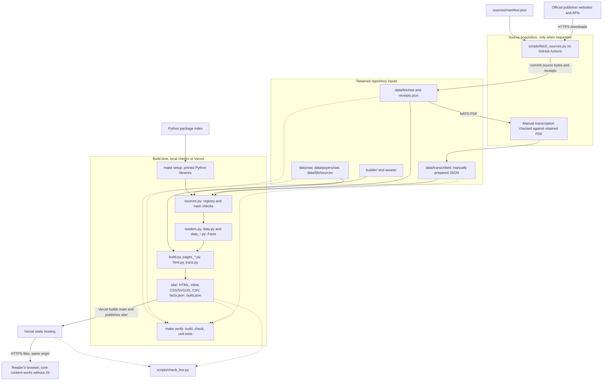

# Service architecture and dependencies

This describes the implemented application, not the future product backlog.
Unpolitical is a **static website generated by Python**. It has no application
server, serverless functions, database, queue, user accounts or browser-time
statistics API. Official data is retained in Git, transformed at build time,
then served as files by Vercel.

## Architecture diagram

Solid arrows show data or artifact flow. Dotted arrows show checks, not a
deployment gate: Vercel builds separately from GitHub Actions.

## Components and data flow

1. **Acquire, separately from building.**
   [The manifest](../sources/manifest.json) configures downloads.
   [The fetcher](../scripts/fetch_sources.py) uses standard-library HTTP requests,
   either to a fixed URL or to a link found on a publisher page. It keeps the
   response bytes and records the resolved URL, retrieval time, content type,
   byte count and SHA-256 in `data/fetched/receipts.json`.
   [The fetch workflow](../.github/workflows/fetch-sources.yml) runs on pushes
   changing the manifest, fetcher or workflow, or by manual dispatch. It commits
   downloaded files back to the checked-out branch. It is not a scheduled
   refresh service.
2. **Verify and read retained inputs.**
   [The source registry](../builder/sources.py) combines explicit entries with
   downloaded-file receipts. `verify_hashes()` runs before rendering.
   [Readers](../builder/readers.py) handle spreadsheets, CSV and PDF; domain
   readers in `data_*.py` also interpret retained JSON and other source formats.
   [The Fact model](../builder/data.py) holds each value, period, unit, source,
   locator and status, with formulas and input IDs for derived figures. Missing
   values remain missing. Downloading a file alone does not add it to the site:
   the registry and domain reader must use it.

   **Manual input boundary:** `data/transcribed/` holds manually prepared JSON.
   [The NATO reader](../builder/data_nato.py) reads defence figures from this
   JSON, not directly from the retained PDF. Automated checks re-read the JSON;
   they do not independently validate the transcription against the PDF.
   Updating this series requires a visual or OCR-assisted comparison against
   the official PDF, review of the JSON values and locators, and an updated
   registry hash. Fetching a replacement PDF alone does not refresh the series.
3. **Render complete pages and provenance.**
   [The build entry point](../builder/build.py) orchestrates readers and page
   generators. Some pages add derived facts, so render order matters.
   [HTML helpers](../builder/html.py) render charts and table alternatives;
   [trace helpers](../builder/trace.py) add figure records and source links;
   [downloads](../builder/downloads.py) produces CSV alternatives.
   The build recreates `site/`, which is ignored generated output, not an input.
   It writes HTML, CSV, the icon, `data/facts.json` and `build.json`.
4. **Check the artifact.**
   `make verify` builds, runs [source and page checks](../builder/check.py),
   then unit tests. Checks re-read source locators, recompute arithmetic,
   validate displayed figures and internal links, and enforce wording and page
   rules. [PR CI](../.github/workflows/check.yml) runs verification and a separate
   browser accessibility job (`make a11y`, Playwright/Chromium and axe).
5. **Publish and read.**
   [Vercel configuration](../vercel.json) runs `make setup`, then `make build`,
   and publishes `site/` for `main` only. Other branches do not deploy.
   Browsers receive pre-rendered pages, inline styles and charts, with inline
   JavaScript for enhancements, not for fetching official statistics.
   Year and comparison answers and tables work without JavaScript. Source links
   let readers visit publishers, but those sites are not needed to render an
   already-built page.

## External service dependencies

All publisher dependencies below are **source-acquisition dependencies**, not
live application backends. The manifest is the authority for configured download
URLs; the source registry also records older retained sources that are not
downloaded by that manifest. Receipts record the URLs actually retrieved.

| Service / hosts | Purpose and interface | Caller / required when |
| --- | --- | --- |
| ONS (`www.ons.gov.uk`), Nomis (`www.nomisweb.co.uk`) | Statistical files and commentary; Nomis `/api/v01/` CSV queries for employment and earnings | Fetcher during acquisition; existing snapshots during builds |
| GOV.UK (`www.gov.uk`, `assets.publishing.service.gov.uk`), OBR (`obr.uk`), DMO (`www.dmo.gov.uk`) | Treasury, HMRC, DWP and housing publications, tax-rate guidance, fiscal tables and explanations; HTTPS spreadsheets, documents and HTML | Fetcher during acquisition; registry also describes retained fiscal files |
| DfE (`explore-education-statistics.service.gov.uk`, `api.education.gov.uk`) | Schools releases and class-size JSON; the registry records the retained DfE statistics API query | Fetcher for configured release pages; retained API snapshot during builds |
| Devolved statistics (`www.gov.wales`, `api.stats.gov.wales`, `www.gov.scot`, `www.education-ni.gov.uk`, `www.communities-ni.gov.uk`) | Nation-specific schools and housing files, including Welsh dwelling-stock CSV API | Fetcher during acquisition |
| VisitBritain (`www.visitbritain.org`) | Domestic tourism tables and reports, including PDFs | Fetcher during acquisition |
| Eurostat (`ec.europa.eu`), OECD (`sdmx.oecd.org`), IMF (`www.imf.org`) | Eurostat dissemination JSON, OECD SDMX CSV and IMF DataMapper JSON for international comparisons | Fetcher during acquisition |
| NATO (`www.nato.int`), NHS Digital (`digital.nhs.uk`), Bank of England (`www.bankofengland.co.uk`) | Defence reports, NHS workforce files and mortgage-rate CSV | Fetcher during acquisition |
| Parliament (`api.parliament.uk`), document archive (`dera.ioe.ac.uk`), data catalogue (`www.data.gov.uk`) | Historical policy records, archived reports and source discovery | Fetcher during acquisition; not every manifest entry is rendered |
| GitHub / GitHub Actions | Git source and PR checks; fetch workflow writes retained files; live workflow compares the deployed build | Development, acquisition and verification, not page rendering |
| Python package index and package-download hosts | Install pinned `openpyxl`, `pypdf`, `xlrd`; development requirements add Playwright and axe tooling | `make setup` / `make setup-dev`; browser tests also download Chromium |
| Vercel (`unpoliticalaf.vercel.app`) | Build and static HTTPS hosting; serves HTML, CSV and JSON files | Production page requests and live checks |

Publisher URLs are public reads; the fetcher has no API-key configuration.
GitHub's fetch workflow uses its workflow token to commit files. Vercel's Git
integration is managed outside the application. No publisher or deployment
credentials are embedded in generated pages. There is no separate frontend
package build: [package.json](../package.json) wraps the Make commands.
Build libraries are pinned in [requirements.txt](../requirements.txt);
test/browser libraries are in [requirements-dev.txt](../requirements-dev.txt).

## Failure boundaries and operational checks

- **Publisher outage or rate limit:** blocks acquiring affected sources, not
  reading the current site or rebuilding from complete retained inputs.
  The fetcher retries requests and skips already-retained downloads by default;
  `--refresh` re-downloads them. Inspect its `FAIL` messages, final failures list
  and receipts: individual download failures are reported but do not make the
  current script exit nonzero. An incomplete batch can therefore be committed.
- **Changed source bytes or layout:** hash mismatches stop the build. A hash
  proves retained-byte identity, not that the correct cells were selected.
  Review the registry, receipts and reader locators together after an update,
  then run `make verify`; never accept a new hash without reviewing the data.
- **Package-download outage:** may block a fresh `make setup` or Vercel build,
  but does not create a browser-time dependency on the package index.
- **Check or deployment failure:** CI verification and Vercel's build are
  separate paths; a green PR alone is not evidence that production matches it.
  [Version metadata](../builder/version.py) uses `VERCEL_GIT_COMMIT_SHA` or local
  Git HEAD. `site/build.json` records that commit and hashes every generated file
  except itself. `make live` builds locally and
  [compares the live commit, file list and served bytes](../scripts/check_live.py).
  [The live workflow](../.github/workflows/live.yml) runs on main pushes, daily,
  or by manual dispatch. Run live comparisons against the intended deployed
  commit, not an unmerged branch.
- **Hosting outage:** prevents fetching the site, but there is no application
  database or worker to recover. The repository and retained inputs are the
  rebuild source; `site/` is disposable. This document does not change deployment
  policy or enable any automation.

Update this document when adding a network caller, runtime service, data store,
source-acquisition route or deployment step. Keep product requirements in
[product-spec.md](product-spec.md) and operating context in [HANDOFF.md](HANDOFF.md).
